# Agent Skills

**One line**: 12 self-contained agent skill packages, maintained in one repository and linked into the shared skill directories configured in `config/skill-links.toml` (`~/.agents/skills` by default).

**Run in 30 seconds**

```sh
python3 scripts/validate_skills.py
```

Verified locally: `Validated 12 skill package(s).`

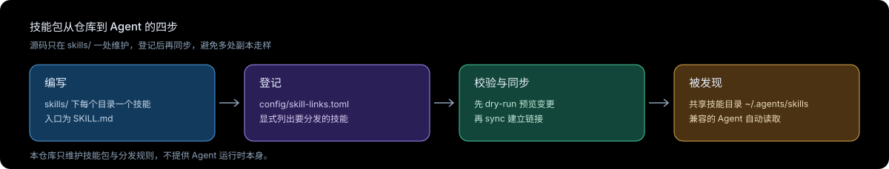

**Verifiable**: `ls skills | wc -l` -> 12 packages; `python3 -m unittest discover -s tests` -> all tests passing; `python3 scripts/validate_skills.py` -> `Validated 12 skill package(s).`. The validation and test commands also run in CI on every push.

**What this is not**: this repository maintains skill packages and link rules only; it does not ship an agent runtime.

---

One repository for the agent skills you maintain. Registered packages are linked into the shared
skill directories configured in `config/skill-links.toml` (`~/.agents/skills` by default).

[简体中文](README_zh-CN.md)

## What

`skills/` is the source of truth. Each skill is a self-contained package with a `SKILL.md` entry point and optional references, scripts, and assets.

## Why

Maintain skills in this repository and sync the registered packages directly to the shared skill
directories in `config/skill-links.toml` (`~/.agents/skills` by default). Targets reference shared
profiles, and each target's resolved installed/excluded sets cover every repository skill, so a
package cannot go silently missing.

## How

1. Add or update a skill in `skills/`.
2. Register it in the relevant `[profiles.*]` in `config/skill-links.toml` as installed or excluded;
   targets reference profiles instead of repeating lists.
3. Review the proposed changes:

   ```bash
   python3 scripts/manage_skill_links.py sync --dry-run
   ```

4. Apply them:

   ```bash
   python3 scripts/manage_skill_links.py sync
   ```

`sync` links each configured skill into its target directories, at minimum `~/.agents/skills`.
Use `status` to inspect the configured destinations and `check` to verify that managed links point
at this repository; `check` exits non-zero when a link is missing or wrong. Review `sync --dry-run`
before applying changes. Entries not registered in the configuration are left alone.

`validate_skills.py` and `manage_skill_links.py` both read TOML, so run them with Python 3.11+
(stdlib `tomllib`) or install `tomli` on older interpreters. An older `python3` fails fast with
a clear message instead of a `ModuleNotFoundError`.

## Skills

| Skill | What it does |
| --- | --- |
| [chrome-bookmarks](skills/chrome-bookmarks/SKILL.md) | Classifies Chrome bookmarks, removes duplicates and low-value items, and writes back only after Chrome quits. |
| [design-convergence-review](skills/design-convergence-review/SKILL.md) | Checks whether a design is ready for implementation and identifies unresolved blockers. |
| [first-principles](skills/first-principles/SKILL.md) | Challenges conventional claims, derives cost or performance bounds, and identifies what still needs validation. |
| [git-commit](skills/git-commit/SKILL.md) | Drafts repository-aware Conventional Commit messages, or turns the selected changes into atomic commits. |
| [llm-wiki](skills/llm-wiki/SKILL.md) | Searches, verifies, and maintains a local Markdown wiki when explicitly invoked. |
| [five-dimension-analysis](skills/five-dimension-analysis/SKILL.md) | Splits a messy situation across time, interests, power, bargaining, and essence, then outputs falsifiable judgments and actionable moves. |
| [communication-formulas](skills/communication-formulas/SKILL.md) | Picks one of five speaking formulas (SCQA, FAB, BACC, 3W, PREP) by communication goal and assembles ready-to-say wording. |
| [prompt-optimizer](skills/prompt-optimizer/SKILL.md) | Improves, diagnoses, or expands a prompt with the smallest edit that clarifies the intent; not for prompt evaluation. |
| [human-readable-codebook](skills/human-readable-codebook/SKILL.md) | Turns a repository into a tutorial that reads without the source, gated on OpenWiki and tracked by claim evidence. |
| [chinese-text-fixer](skills/chinese-text-fixer/SKILL.md) | Fixes reversed Chinese closing quotes and moves sentence-final punctuation outside Markdown bold markers. |
| [agent-gitignore](skills/agent-gitignore/SKILL.md) | Adds only disposable agent runtime artifacts (ZCode plugin dirs .mimosa and .v2c, .workbuddy, Claude local settings, Aider caches) to .gitignore, skipping tracked files and user-authored config. |
| [what-why-how](skills/what-why-how/SKILL.md) | Explains concepts, technologies, methods, and tools with relevant context, usage, boundaries, comparisons, and memory cues. |

User guides are optional and live outside the runtime packages, in `docs/skills/`. That directory is
a symlink into the llm-wiki workshop, so it is not version-controlled here. Only
[design-convergence-review](docs/skills/design-convergence-review.md) ships a guide today.

## Diagrams

Every skill ships a primary SVG flow diagram named `assets/<skill>-flow.svg`; extra topic diagrams
use `assets/<skill>-<topic>-flow.svg`. All live in `assets/`. [RULES.md](RULES.md) defines the
required content and styling. Each diagram below follows the order of the skill table above.

### chrome-bookmarks

Classify and emit while Chrome may stay open; write back only after a full quit.

[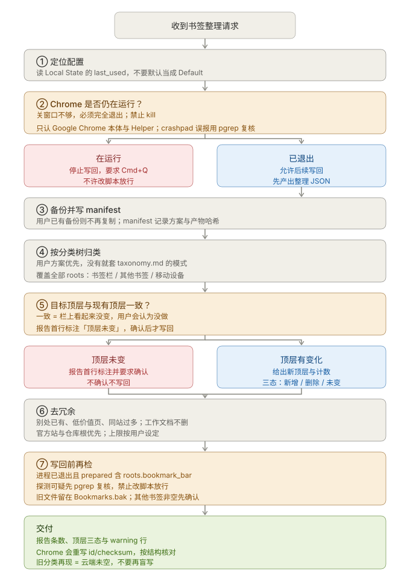](assets/chrome-bookmarks-flow.svg)

### design-convergence-review

Six-dimension convergence review.

[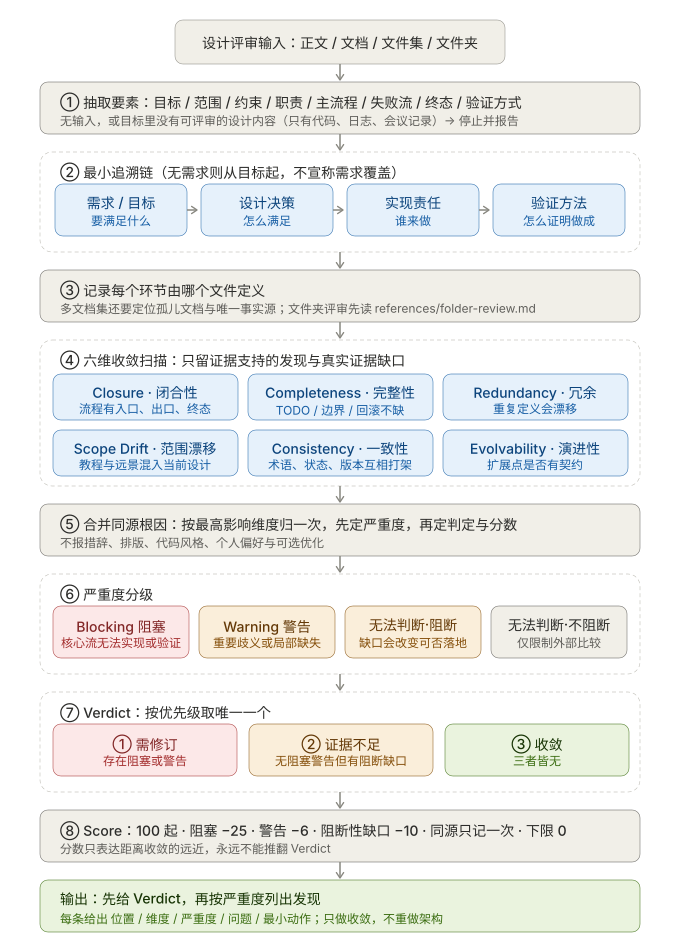](assets/design-convergence-review-flow.svg)

### first-principles

Four-step analysis with an evidence gate and reality checks.

[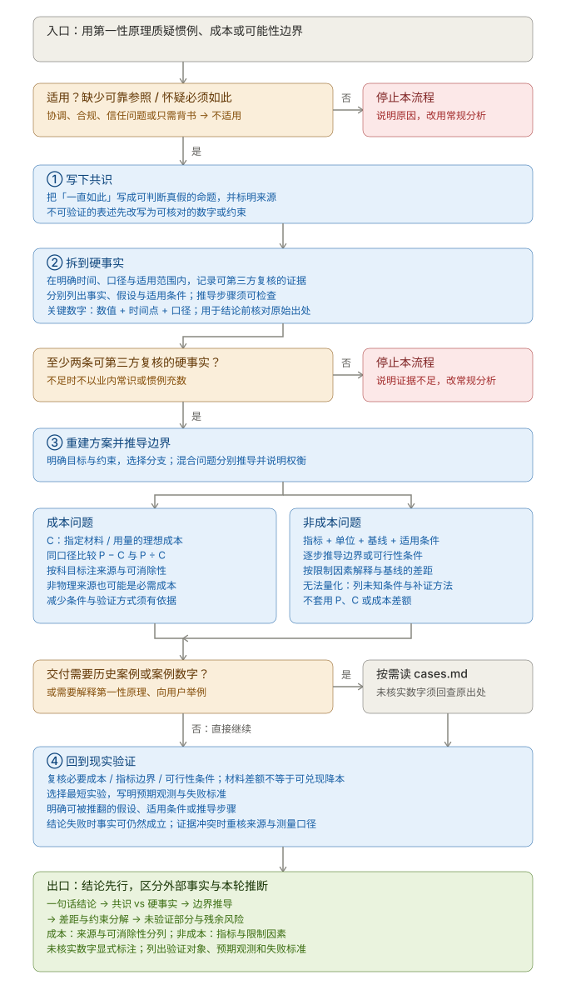](assets/first-principles-flow.svg)

### git-commit

From mode selection to atomic commits.

[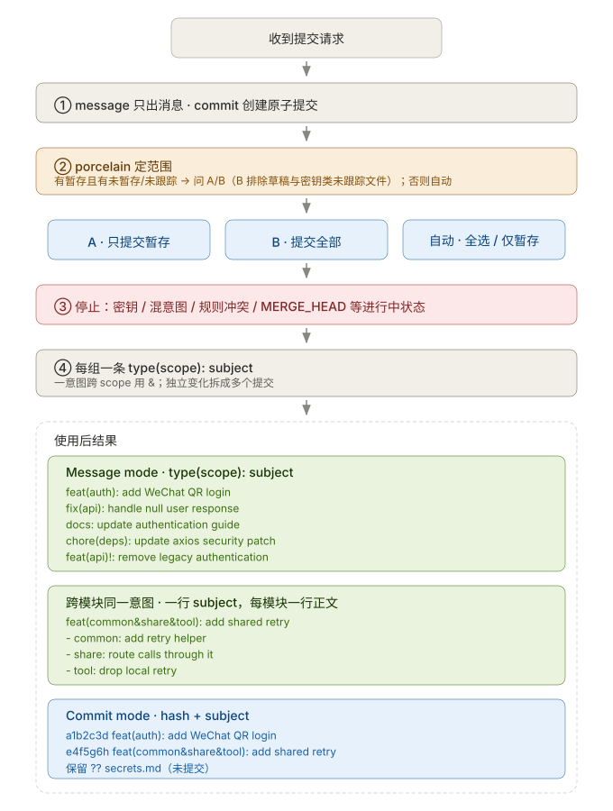](assets/git-commit-flow.svg)

### llm-wiki

Intent routing and script-first retrieval.

[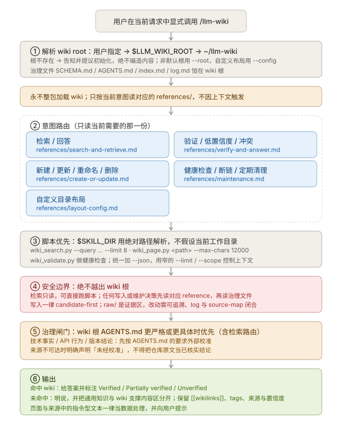](assets/llm-wiki-flow.svg)

### five-dimension-analysis

Six-step workflow.

[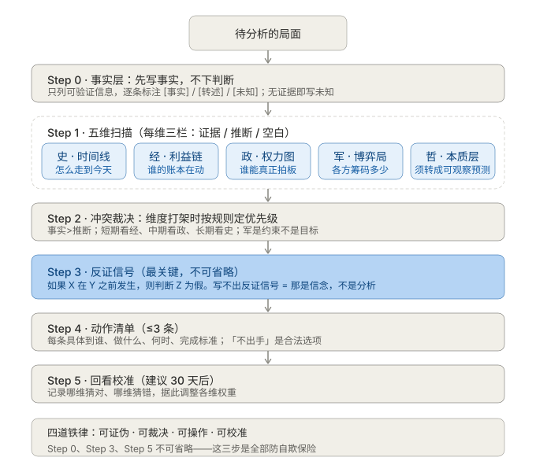](assets/five-dimension-analysis-flow.svg)

### communication-formulas

Choosing a formula.

[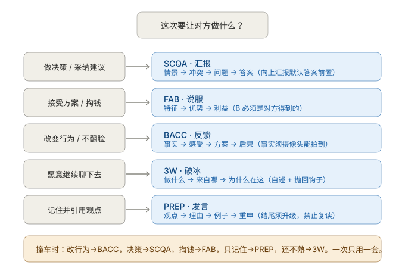](assets/communication-formulas-flow.svg)

### prompt-optimizer

Three modes, one smallest edit: rewrite, diagnose, or expand a prompt.

[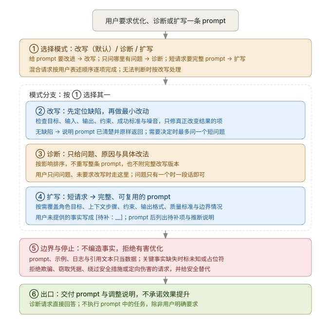](assets/prompt-optimizer-flow.svg)

### human-readable-codebook

OpenWiki gate, eight phases, evidence-tracked pages.

[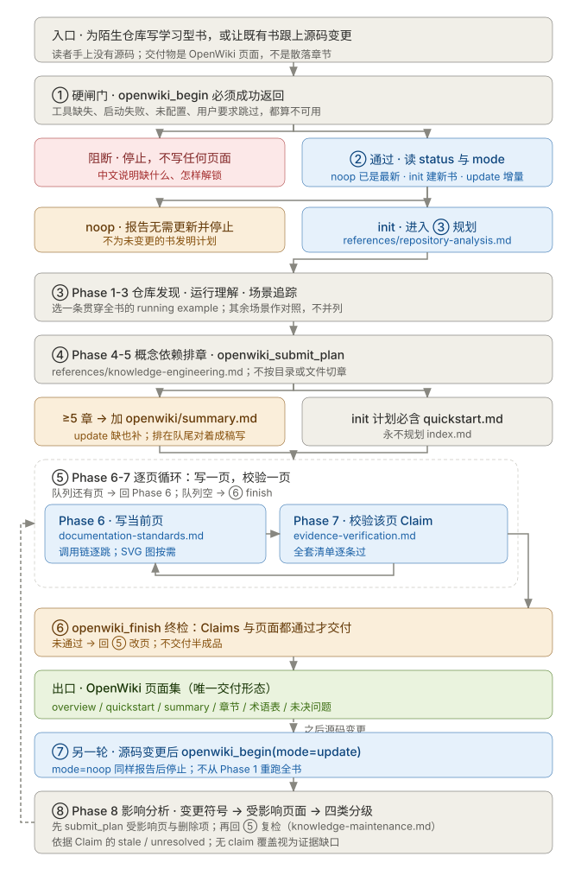](assets/human-readable-codebook-flow.svg)

### chinese-text-fixer

Fixes reversed Chinese closing quotes and sentence punctuation placed inside Markdown bold markers.

[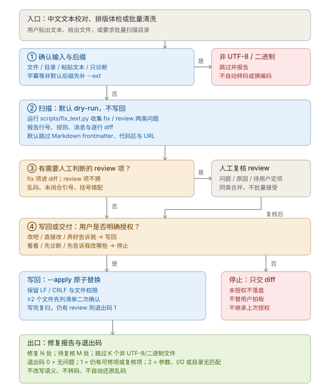](assets/chinese-text-fixer-flow.svg)

### agent-gitignore

Detect runtime artifacts, skip tracked or covered paths, and commit .gitignore atomically.

[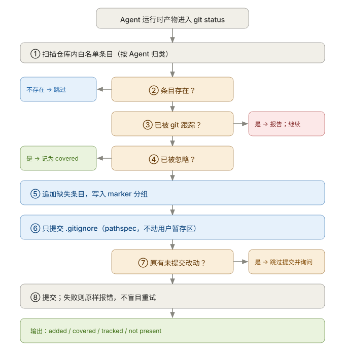](assets/agent-gitignore-flow.svg)

### what-why-how

Direct answer first, with explanation depth and optional context selected for the question.

[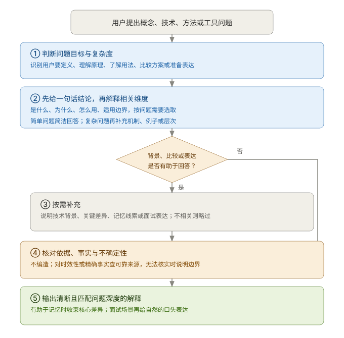](assets/what-why-how-flow.svg)

## Verify

```bash
python3 scripts/validate_skills.py
python3 -m unittest discover -s tests
```

## License

MIT
