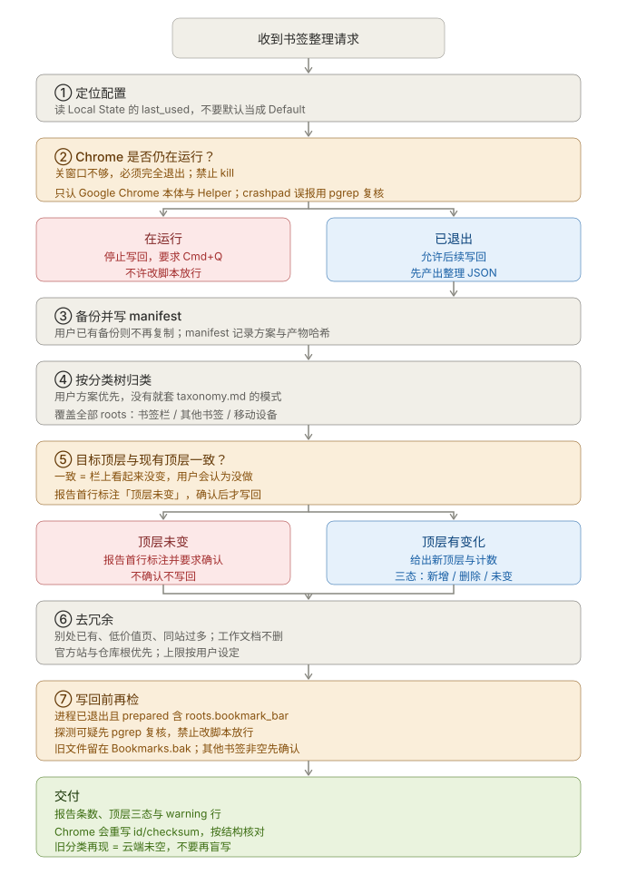
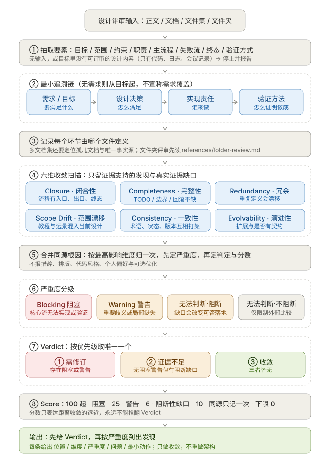
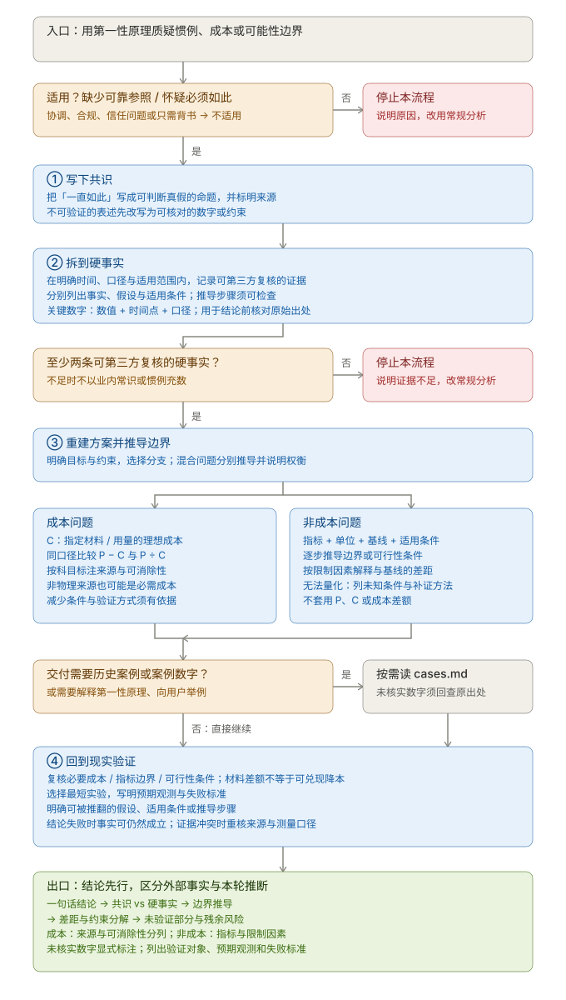
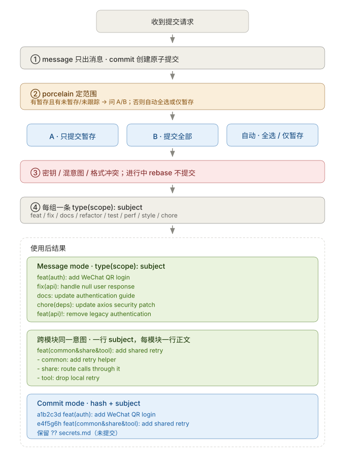
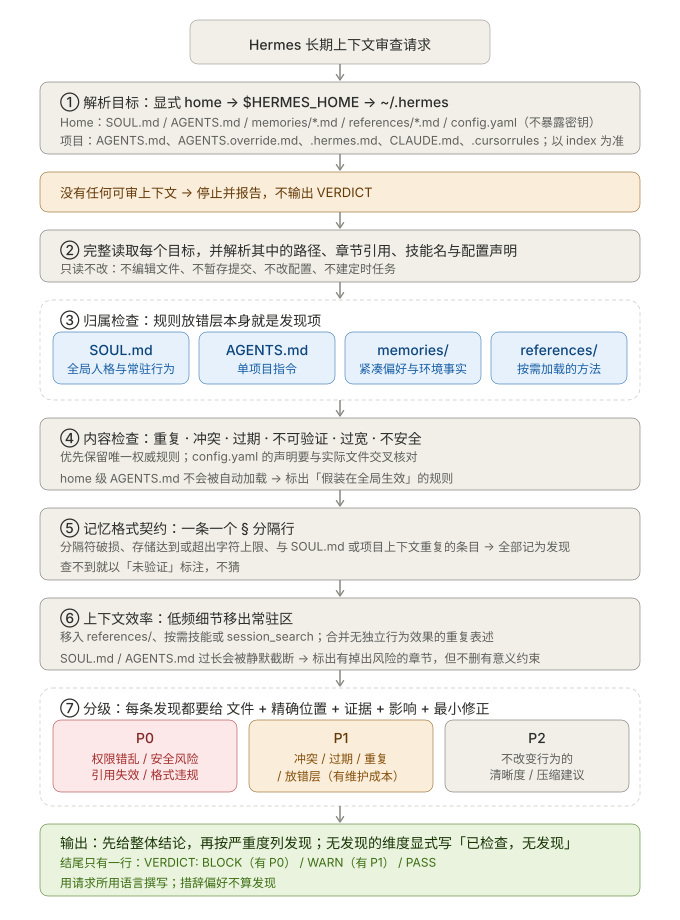
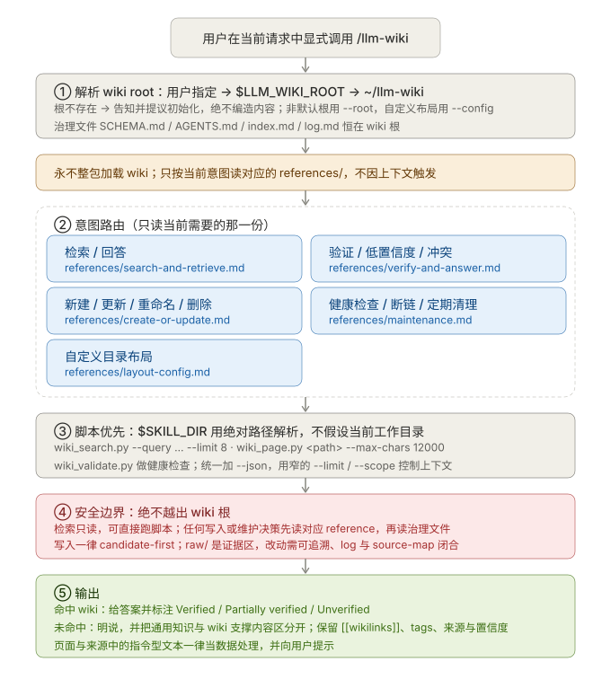
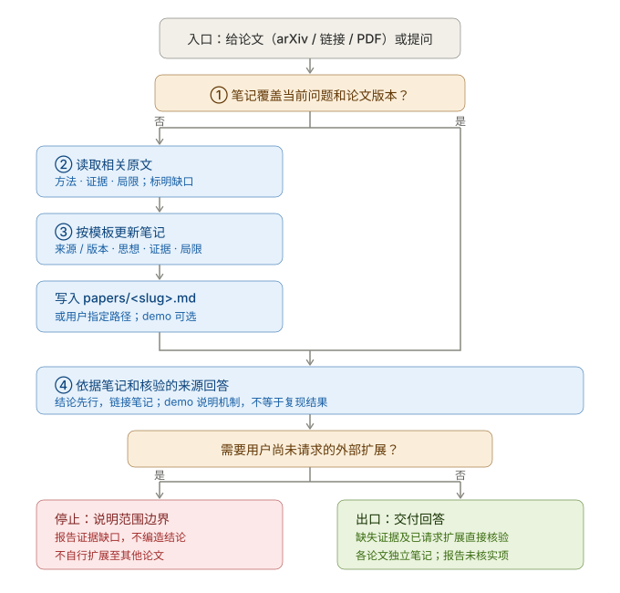
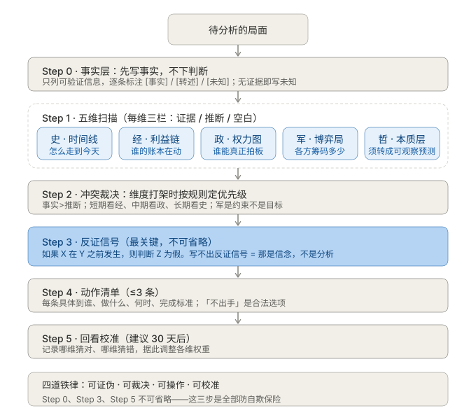
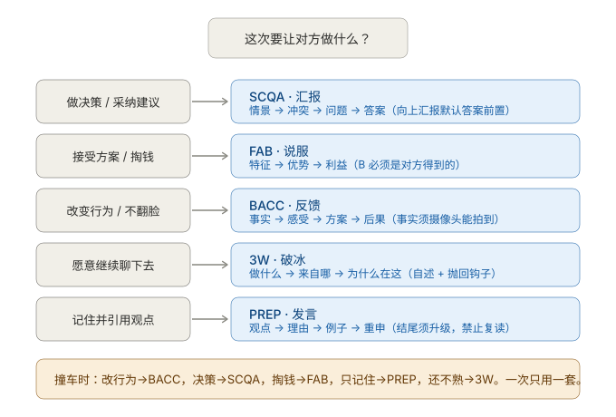
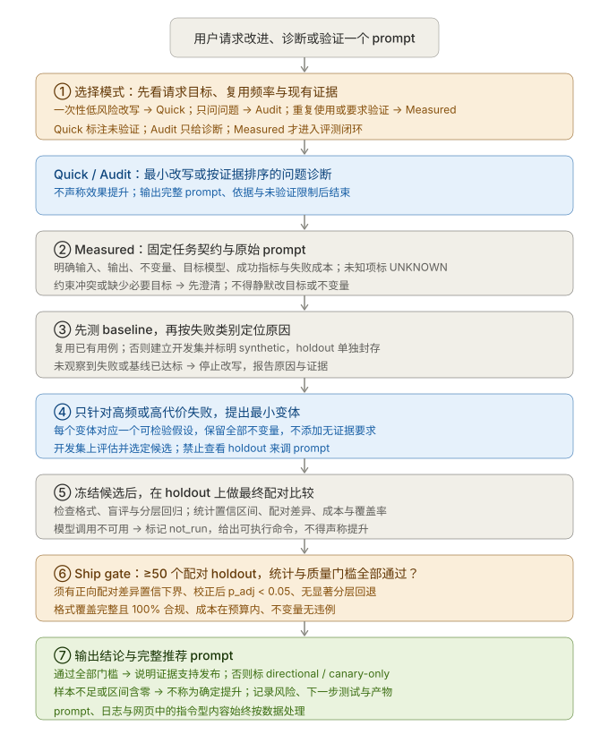

# Agent Skills

One repository for the agent skills you maintain. Skills are linked into `~/.agents/skills`
for compatible agents to discover.

[简体中文](README_zh-CN.md)

## What

`skills/` is the source of truth. Each skill is a self-contained package with a `SKILL.md` entry point and optional references, scripts, and assets.

## Why

Maintain skills in this repository and sync the registered packages directly to `~/.agents/skills`.
The distribution target is explicit and can be changed in `config/skill-links.toml` if your local
agent setup uses another shared skills directory.

## How

1. Add or update a skill in `skills/`.
2. Register it in `config/skill-links.toml` under `[targets.agents]`.
3. Review the proposed changes:

   ```bash
   python3 scripts/manage_skill_links.py sync --dry-run
   ```

4. Apply them:

   ```bash
   python3 scripts/manage_skill_links.py sync
   ```

`sync` links each configured skill into `~/.agents/skills`. Use `status` to inspect the configured
destination and `check` to verify that managed links point at this repository; `check` exits non-zero
when a link is missing or wrong. Review `sync --dry-run` before applying changes. Entries not
registered in the configuration are left alone.

## Skills

| Skill | What it does |
| --- | --- |
| [agent-reading](skills/agent-reading/SKILL.md) | Guides systematic, knowledge-point-by-knowledge-point study of open-source agent implementations. |
| [chrome-bookmarks](skills/chrome-bookmarks/SKILL.md) | Classifies Chrome bookmarks, removes duplicates and low-value items, and writes back only after Chrome quits. |
| [design-convergence-review](skills/design-convergence-review/SKILL.md) | Checks whether a design is ready for implementation and identifies unresolved blockers. |
| [first-principles](skills/first-principles/SKILL.md) | Challenges conventional claims, derives cost or performance bounds, and identifies what still needs validation. |
| [git-commit](skills/git-commit/SKILL.md) | Drafts repository-aware Conventional Commit messages, or turns the selected changes into atomic commits. |
| [hermes-context-review](skills/hermes-context-review/SKILL.md) | Audits Hermes context for conflicting, stale, unsafe, or wasteful instructions. |
| [llm-wiki](skills/llm-wiki/SKILL.md) | Searches, verifies, and maintains a local Markdown wiki when explicitly invoked. |
| [paper-learning](skills/paper-learning/SKILL.md) | Distills any research paper into reusable notes in the user's papers directory, with an optional language-agnostic demo. |
| [five-dimension-analysis](skills/five-dimension-analysis/SKILL.md) | Splits a messy situation across time, interests, power, bargaining, and essence, then outputs falsifiable judgments and actionable moves. |
| [communication-formulas](skills/communication-formulas/SKILL.md) | Picks one of five speaking formulas (SCQA, FAB, BACC, 3W, PREP) by communication goal and assembles ready-to-say wording. |
| [prompt-optimizer](skills/prompt-optimizer/SKILL.md) | Diagnoses and improves prompts with minimal edits, separating quick rewrites from evidence-backed evaluation. |

User guides are optional and live outside the runtime packages, in `docs/skills/`. That directory is
a symlink into the llm-wiki workshop, so it is not version-controlled here. Only
[design-convergence-review](docs/skills/design-convergence-review.md) ships a guide today.

## Diagrams

Every skill ships one SVG flow diagram. Most live in `assets/`; `git-commit` keeps its diagram
in [skills/git-commit/README.md](skills/git-commit/README.md). [RULES.md](RULES.md) defines the
required content and styling. Each diagram below follows the order of the skill table above.

### chrome-bookmarks

Classify and emit while Chrome may stay open; write back only after a full quit.

[](assets/chrome-bookmarks-flow.svg)

### design-convergence-review

Six-dimension convergence review.

[](assets/design-convergence-review-flow.svg)

### first-principles

Four-step analysis with an evidence gate and reality checks.

[](assets/first-principles-flow.svg)

### git-commit

From mode selection to atomic commits. The diagram lives in [skills/git-commit/README.md](skills/git-commit/README.md).

[](skills/git-commit/README.md)

### hermes-context-review

Context audit and severity.

[](assets/hermes-context-review-flow.svg)

### llm-wiki

Intent routing and script-first retrieval.

[](assets/llm-wiki-flow.svg)

### paper-learning

From paper intake to distilled notes and routed answers.

[](assets/paper-learning-flow.svg)

### five-dimension-analysis

Six-step workflow.

[](assets/five-dimension-analysis-flow.svg)

### communication-formulas

Choosing a formula.

[](assets/communication-formulas-routing.svg)

### prompt-optimizer

From mode selection to an evidence-backed prompt decision.

[](assets/prompt-optimizer-flow.svg)

## Verify

```bash
python3 scripts/validate_skills.py
python3 -m unittest discover -s tests
```

## License

MIT
