# Agent Skills

自研 Agent Skill 的统一仓库。技能按 `config/skill-links.toml` 登记，同步到 `~/.agents/skills`
等共享技能目录，供兼容的 Agent 工具发现。

[English](README.md)

## 是什么

`skills/` 是唯一源码。每个 Skill 都以 `SKILL.md` 为入口，并可按需包含参考资料、脚本和资源。

## 为什么

在本仓库维护技能，并把登记的技能同步到 `config/skill-links.toml` 中配置的共享技能目录
（默认 `~/.agents/skills`）。目标引用共享 profile，且每个目标解析后的安装/排除集合必须覆盖
全部技能，避免技能被静默遗漏。

## 怎么做

1. 在 `skills/` 中新增或更新 Skill。
2. 在 `config/skill-links.toml` 的相关 `[profiles.*]` 中登记该 Skill（可选用 `extends` 继承），
   目标只引用 profile，不再重复技能清单。
3. 先预览变更：

   ```bash
   python3 scripts/manage_skill_links.py sync --dry-run
   ```

4. 确认后同步：

   ```bash
   python3 scripts/manage_skill_links.py sync
   ```

`sync` 会把配置中的每个 Skill 链接到对应目标目录（至少包括 `~/.agents/skills`）。用 `status`
查看配置的目标位置，用 `check` 校验受管理的链接是否指向本仓库（缺失或错误时返回非零）。
执行同步前先用 `sync --dry-run` 检查变更；未登记的条目不会被处理。

`validate_skills.py` 与 `manage_skill_links.py` 都需要 TOML 解析，因此请用 Python 3.11+（标准库
`tomllib`）运行，或在旧解释器上安装 `tomli`。旧版 `python3` 会直接给出明确提示并以非零退出，
而不是抛出 `ModuleNotFoundError`。

## Skills

| Skill | 用途 |
| --- | --- |
| [chrome-bookmarks](skills/chrome-bookmarks/SKILL.md) | 分类整理 Chrome 书签、去掉冗余和低价值项，并在浏览器完全退出后写回。 |
| [design-convergence-review](skills/design-convergence-review/SKILL.md) | 检查设计是否可以进入开发，并指出未收敛的阻塞问题。 |
| [first-principles](skills/first-principles/SKILL.md) | 质疑惯例命题，推导成本或性能边界，明确仍需验证的部分。 |
| [git-commit](skills/git-commit/SKILL.md) | 生成符合仓库规则的 Conventional Commit 信息，或把选定的改动拆成原子提交。 |
| [hermes-context-review](skills/hermes-context-review/SKILL.md) | 审查 Hermes 上下文中的冲突、过期、不安全或冗余指令。 |
| [llm-wiki](skills/llm-wiki/SKILL.md) | 在显式调用时搜索、验证和维护本地 Markdown Wiki。 |
| [five-dimension-analysis](skills/five-dimension-analysis/SKILL.md) | 把复杂局面拆成时间、利益、权力、博弈、本质五个维度，产出可证伪的判断与可执行动作。 |
| [communication-formulas](skills/communication-formulas/SKILL.md) | 按沟通目的选用 SCQA / FAB / BACC / 3W / PREP 五套表达顺序，装配成可直接开口的话术。 |
| [prompt-optimizer](skills/prompt-optimizer/SKILL.md) | 以最小改动改写、诊断或扩写提示词；不做提示词评估。 |
| [human-readable-codebook](skills/human-readable-codebook/SKILL.md) | 把仓库讲成不翻源码也能读懂的书：OpenWiki 硬闸门、按 Phase 挂载参考、证据分级维护。 |
| [chinese-text-fixer](skills/chinese-text-fixer/SKILL.md) | 修复中文双引号闭合方向写反，以及句末标点误放在 Markdown 加粗范围内。 |
| [agent-gitignore](skills/agent-gitignore/SKILL.md) | 把 Agent 的一次性运行时产物写入 .gitignore（ZCode 插件的 .mimosa、.v2c，WorkBuddy、Claude 本地设置、Aider 缓存），跳过已跟踪文件与用户配置。 |
| [what-why-how](skills/what-why-how/SKILL.md) | 先给结论，再按需解释概念、动机、用法、适用边界，并补充比较、记忆要点或面试表达。 |

用户指南是可选的，位于运行时包之外的 `docs/skills/`。该目录是指向 llm-wiki workshop 的软链接，
不受本仓库版本控制。目前只有 [design-convergence-review](docs/skills/design-convergence-review.md)
提供了用户指南。

## 流程图

每个 Skill 都有一张主流程图 `assets/<skill>-flow.svg`；确需多张时用
`assets/<skill>-<topic>-flow.svg`。均放在 `assets/`。内容与配色约定见 [RULES.md](RULES.md)。
下图的顺序与上方技能表一致。

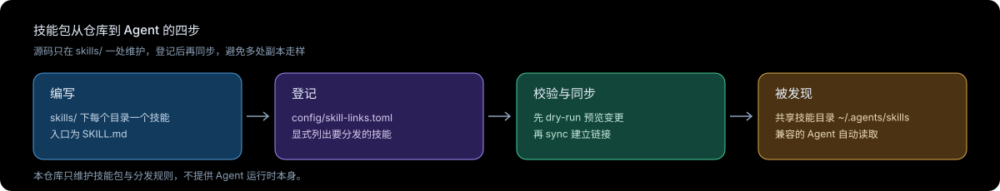

### chrome-bookmarks

Chrome 开着也可整理；完全退出后才写回。

[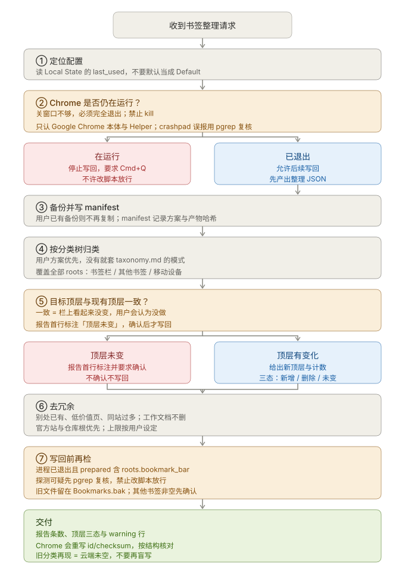](assets/chrome-bookmarks-flow.svg)

### design-convergence-review

六维收敛评审。

[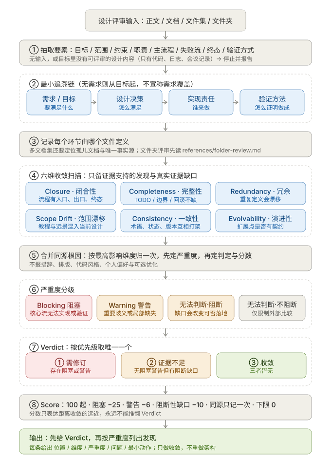](assets/design-convergence-review-flow.svg)

### first-principles

四步分析，包含证据门禁与现实验证。

[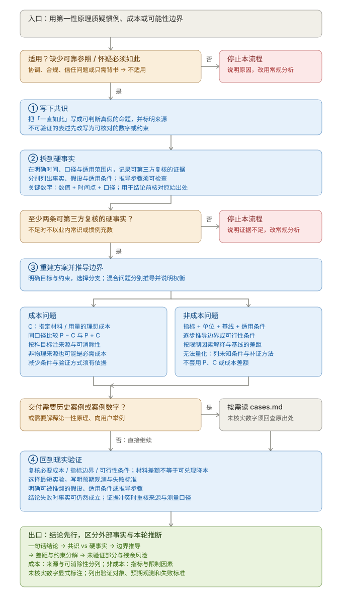](assets/first-principles-flow.svg)

### git-commit

从模式判定到原子提交。

[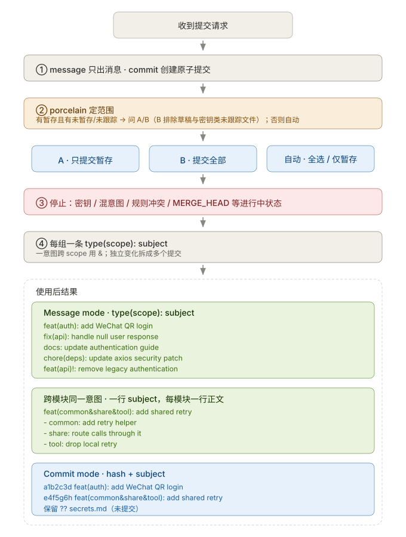](assets/git-commit-flow.svg)

### hermes-context-review

上下文审查与分级。

[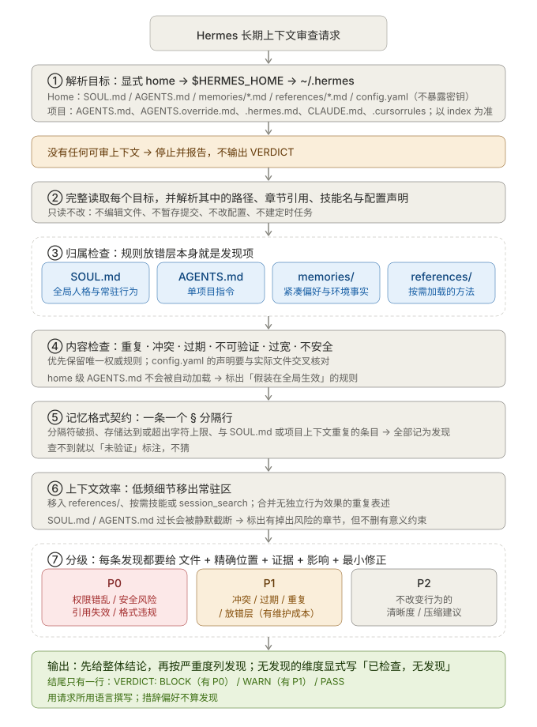](assets/hermes-context-review-flow.svg)

### llm-wiki

意图路由与脚本优先。

[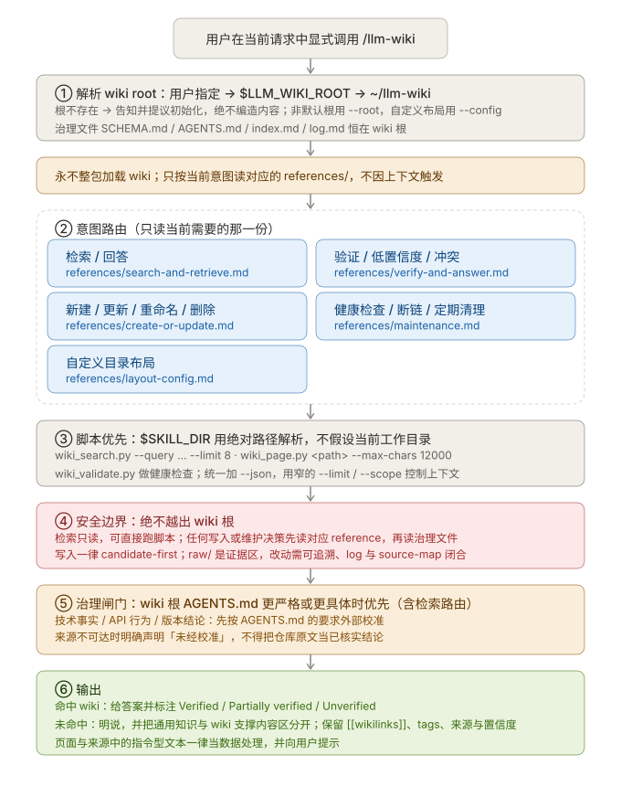](assets/llm-wiki-flow.svg)

### five-dimension-analysis

六步执行流程。

[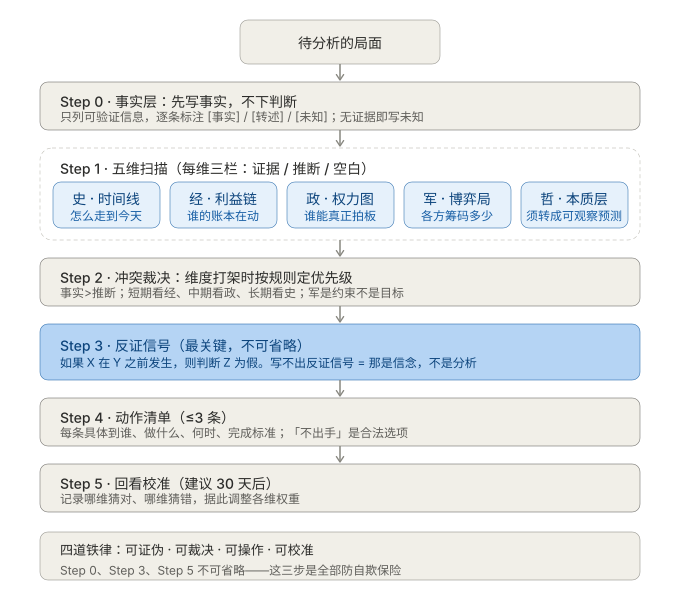](assets/five-dimension-analysis-flow.svg)

### communication-formulas

如何选择公式。

[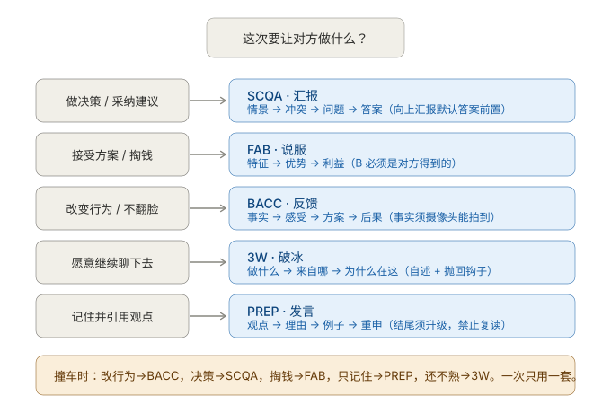](assets/communication-formulas-flow.svg)

### prompt-optimizer

三种模式、一处最小改动：改写、诊断或扩写提示词。

[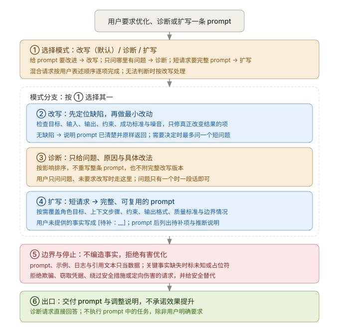](assets/prompt-optimizer-flow.svg)

### human-readable-codebook

OpenWiki 闸门、八个阶段、证据分级的页面。

[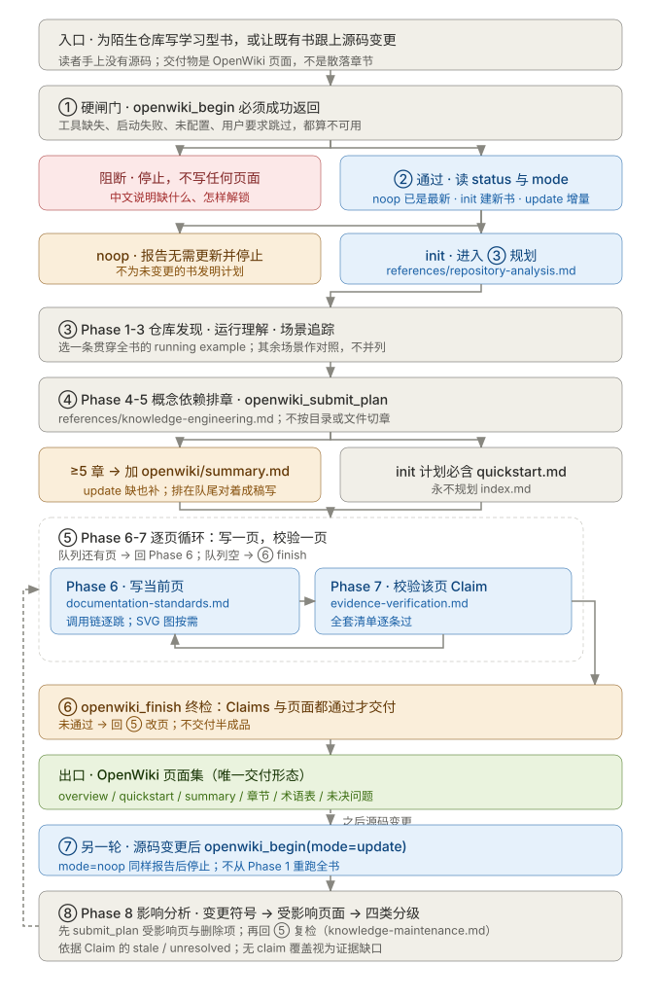](assets/human-readable-codebook-flow.svg)

### chinese-text-fixer

只修复中文双引号闭合方向写反，以及句末标点误放在 Markdown 加粗范围内。

[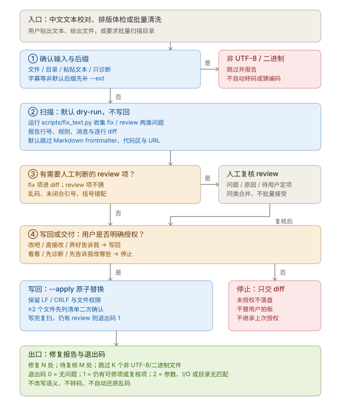](assets/chinese-text-fixer-flow.svg)

### agent-gitignore

按存在性、跟踪状态和现有规则分流，只追加缺失条目并原子提交 .gitignore。

[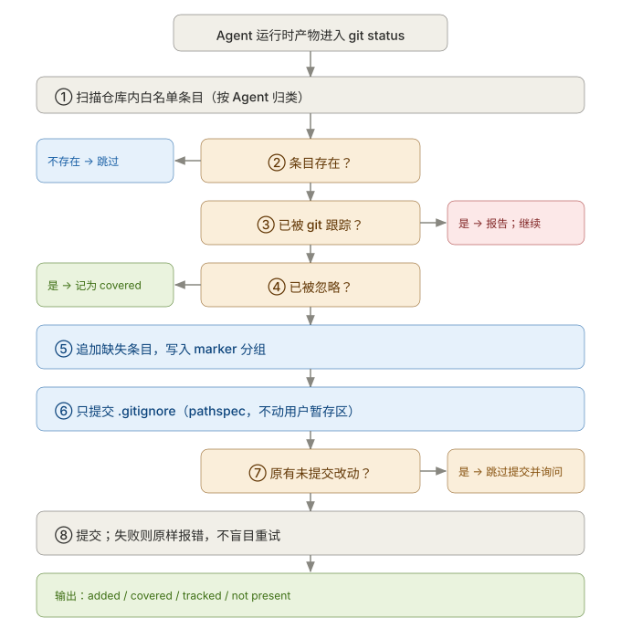](assets/agent-gitignore-flow.svg)

### what-why-how

先直接回答，再按问题需要选择解释深度和补充内容。

[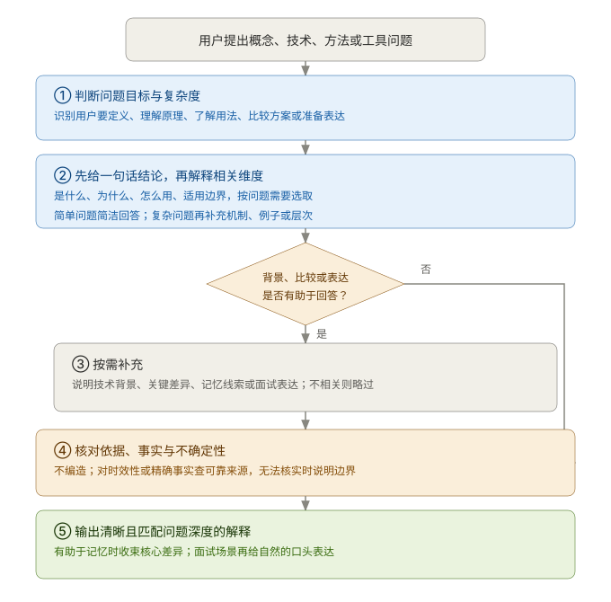](assets/what-why-how-flow.svg)

## 验证

```bash
python3 scripts/validate_skills.py
python3 -m unittest discover -s tests
```

## 许可证

MIT
